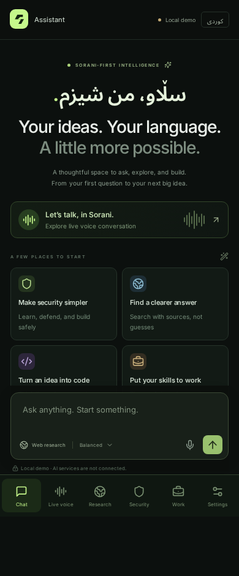

# shizz ai agent
### Sorani-first intelligence. An Android-focused, owner-controlled AI workspace.

**Version 0.1.0 beta · 13 November 2026 · Source project, not a signed APK.**

This ZIP is the requested **single delivery file**. It contains the Android project, backend, real provider adapters, native helper sources, tests and setup instructions. It does **not** contain model weights, subscriptions, API keys, a hosted server or a prebuilt installable APK.

**The two reference files were not provided. They were not reviewed and no ideas are attributed to them.** See [the reference review record](docs/REFERENCE_REVIEW.md).

## Start here

- **Only have an Android phone?** The live browser preview demonstrates the interface. To install a native version, a developer or build service must build the APK from this source and deploy the backend over HTTPS. See [Android build instructions](docs/ANDROID.md). The app does not run Go, Rust and Python toolchains on the phone.
- **Have a computer?** Install Python 3.11+, Node.js 20+, and optionally Go 1.23+ and stable Rust. On Linux/macOS/WSL:

```bash
bash scripts/bootstrap.sh --dev
bash scripts/dev.sh
```

Open `http://localhost:5173`. Demo mode is on by default and **never calls paid model, search or voice APIs**. Secret-pattern checks and proposal drafts work against your local backend; chat uses clearly labelled prewritten examples.

- **Ready for real AI?** Follow [SETUP.md](docs/SETUP.md). Put credentials only on the backend, use a private long device token, set `DEMO_MODE=false`, deploy with HTTPS, and select an account-available chat model.
- **Before relying on Sorani voice:** use the [native-speaker evaluation plan](docs/SORANI_EVALUATION.md).

## What is actually included

| Area | Implementation | Important qualification |
|---|---|---|
| Sorani chat | Sorani-first system policy, ckb vocabulary preferences, RTL-aware rendering, bundled Kurdish-capable font, streaming text | Prompting and provider models, **not** a specially trained Kurdish model; quality must be evaluated |
| Powerful models | OpenAI Responses / Chat Completions, Anthropic Messages, Gemini streaming, one additional OpenAI-compatible endpoint | Credentials and account/model availability required; no arbitrary “strongest” ranking |
| Model routing | Explicit fast/balanced/deep server routes; account model discovery and manual IDs | Profiles only select configured routes; no magic acceleration or silent cross-provider fallback |
| Sorani conversation | Microphone → silence-delimited turn → Google STT V2 `ckb-IQ` → selected chat model → ElevenLabs Sorani TTS | Turn-taking, **not full duplex**; requires Google/LLM/ElevenLabs setup and voice evaluation |
| Direct live voice | OpenAI Realtime WebRTC, server VAD, interruption, data-channel tool requests with user approval | Separate voice model; Sorani quality experimental; provider access required |
| Voice notes | Up to 45 seconds, Sorani transcript review before sending to chat; chat read-aloud | Foreground only; HTTPS and microphone permission required |
| Research | Brave or Tavily search; up to 3 source-page reads; citation context for chat; direct URL reading | Read-only public text/HTML, no JavaScript execution, paywall bypass, logins or full browser automation |
| Cybersecurity | Exact-host scoped HTTP-header review and bounded secret-pattern scanning; defensive assistant policy | No arbitrary shell, exploitation, port sweeps or complete vulnerability scanner |
| Income support | English/Sorani unsent proposals, decimal-safe quotes, human-reviewed service planning and export | Supports legitimate work, **not autonomous earnings**, trading, payments or outreach |
| Privacy | Backend-only provider keys; device token in memory; no automatic transcript persistence; explicit exports | External providers have their own processing/retention policies |

## Interface preview



See also [the voice interface](docs/screenshots/android-voice.png). These are browser screenshots at phone-sized dimensions, not a physical-device test.

## Why these languages are present

- **Python:** FastAPI orchestration, streaming provider adapters, research, authorization, voice services, deterministic proposal generation, Python helper fallbacks.
- **JavaScript / TypeScript:** React mobile interface, Capacitor Android bridge, WebRTC, microphone/VAD pipeline, streaming client and data-channel approvals. App source is TypeScript/TSX, compiled into JavaScript.
- **Go:** `fetchguard`, a bounded public-web HTTP reader with DNS resolution/validation inside the dialer, IP pinning, TLS validation and redirect checks.
- **Rust:** `secretguard`, a bounded stdin-only secret-pattern scanner that does not run user code, read files or access the network. **Rust was selected from your “Rust / C++” choice; C++ is not included.**
- **Bash / Shell:** Setup, build, test, development and Android packaging scripts.
- **Java:** Small standard Android activity glue for lifecycle cleanup; not a replacement for the requested languages.

## Architecture

```text
Android app (React + TypeScript + Capacitor; HTTPS packaged origin)
  ├─ streaming chat / public research / explicit security checks / proposal drafts
  ├─ Sorani turn-taking: microphone → Google ckb-IQ → LLM → ElevenLabs → speaker
  └─ Realtime WebRTC: microphone ⇄ OpenAI voice model
       └─ data-channel tool requests → approval UI → backend read/search only
                  │ HTTPS + owner device token
Python FastAPI backend
  ├─ OpenAI / Anthropic / Gemini / compatible-provider adapters
  ├─ Brave or Tavily search → bounded source extraction
  ├─ Go public-web fetchguard (or DNS-pinned Python implementation)
  ├─ Rust secretguard (or Python pattern implementation)
  └─ deterministic quotes and unsent proposals
```

All paid-service credentials remain on the server. WebRTC audio travels directly between the phone and the voice provider after the backend exchanges the SDP. Raw pipeline audio passes through the backend to Google; response text goes to the configured TTS provider. No model may run a shell command. See [security and privacy](docs/SECURITY.md).

## Project map

```text
START_HERE.html              Friendly offline entry page
.env.example                Server-only configuration template
backend/shizz/              Python implementation
backend/tests/              Automated backend and adapter tests
mobile/src/                 TypeScript interface, API and voice implementations
mobile/android/             Android Studio project, permissions and lifecycle glue
workers/fetchguard/          Go reader source + tests
workers/secretguard/         Rust scanner source + tests
scripts/                    Bash setup/build/test tools + ZIP packager
Dockerfile, compose.yaml    Optional non-root API container
.github/workflows/          Source checks and on-demand debug APK build recipe
/docs/                      Detailed guides, status, references and evaluation plan
```

## Build and test

```bash
bash scripts/build-workers.sh  # Optional native accelerators; Python fallbacks are included
bash scripts/check.sh         # Install dev requirements first; reports skipped native toolchains
bash scripts/build-android.sh # Requires JDK 21, Android SDK 35 and accepted SDK licenses
```

A debug build is for testing. Release signing, store-policy compliance, a production backend, monitoring and device QA are the owner's responsibility. No provider API keys should ever be embedded in an APK or `VITE_*` variable.

Read the measured [TEST_REPORT.md](docs/TEST_REPORT.md) and [FEATURE_STATUS.md](docs/FEATURE_STATUS.md) before interpreting integration code as a validated live service. There are no guarantees of perfect understanding, unlimited capability, latency or earnings.

MIT license for original project code; dependencies and fonts retain their own licenses. See [third-party notices](docs/THIRD_PARTY.md).
